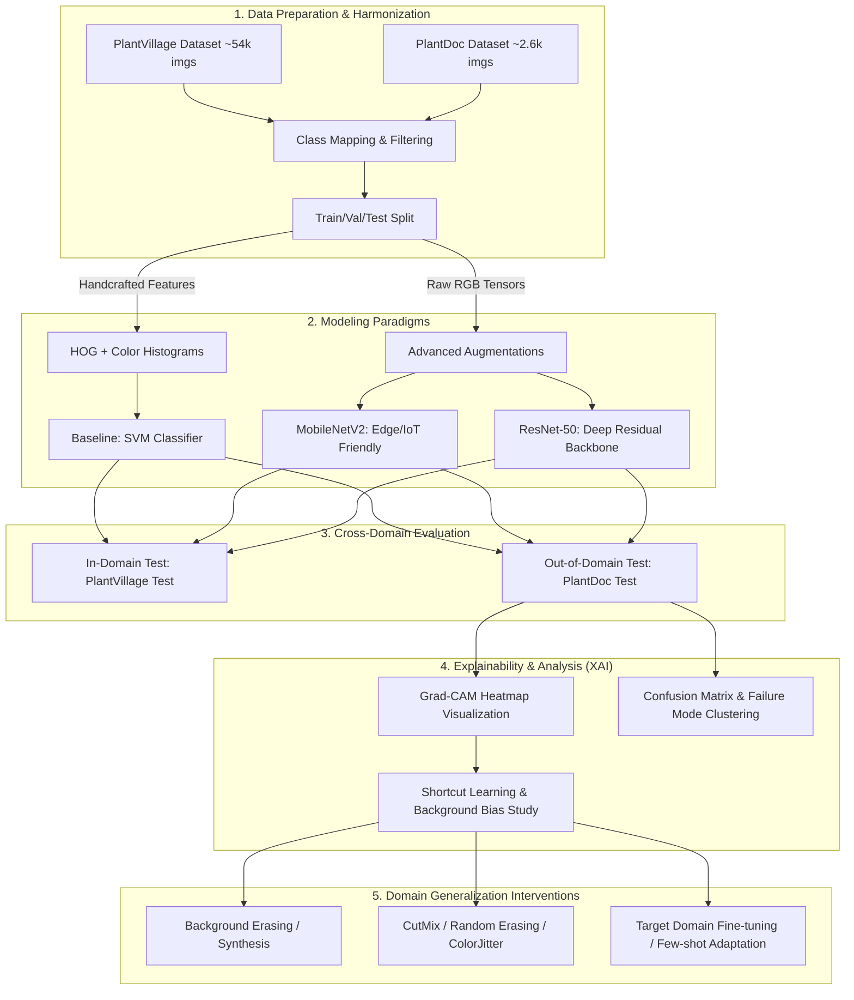

# 🌿 Plant Disease Recognition and Cross-Domain Generalization
### Nhận dạng bệnh cây trồng & Đánh giá khả năng tổng quát hóa từ phòng thí nghiệm sang ảnh thực địa

[](https://www.python.org/)
[](https://pytorch.org/)
[](https://scikit-learn.org/)
[](LICENSE)

---

## 📌 1. Đặt vấn đề & Động lực nghiên cứu (Motivation)

Trong nông nghiệp chính xác (Precision Agriculture), bài toán phát hiện sớm bệnh cây trồng qua hình ảnh đóng vai trò sống còn trong việc giảm thiểu thiệt hại mùa màng và hạn chế lạm dụng thuốc bảo vệ thực vật.

Các mô hình Deep Learning hiện đại (ResNet, MobileNet, Vision Transformers) khi huấn luyện trên tập dữ liệu tiêu chuẩn **PlantVillage** thường đạt độ chính xác gần như tuyệt đối (**> 98-99%**). Tuy nhiên, khi triển khai vào ứng dụng thực tế trên đồng ruộng hoặc kiểm thử chéo trên các tập dữ liệu thực địa như **PlantDoc**, hiệu năng của mô hình thường **tụt giảm nghiêm trọng (xuống còn 25% – 45%)**.

```
  [PlantVillage (Lab)]                       [PlantDoc (Field)]
  - Nền trơn (xám/đen/trắng)                 - Nền tự nhiên: đất, cỏ, bầu trời, bàn tay
  - 1 lá / 1 ảnh, căn giữa                   - Nhiều lá, chồng chéo, lá rách/héo
  - Ánh sáng studio đồng đều                 - Nắng gắt, bóng râm, ngược sáng
  - Camera cố định                           - Độ phân giải đa dạng, rung lắc, mờ
        │                                          │
        ▼                                          ▼
Accuracy: 99.2% (In-domain)                Accuracy: ~32.4% (Out-of-domain)
                     └───► [ SỤT GIẢM 66.8% ] ◄───┘
```

### 🎯 Điểm nhấn cốt lõi của đề tài (Research Core):
Đề tài không chỉ dừng lại ở việc so sánh độ chính xác giữa các mô hình (Baseline vs. Deep Learning), mà tập trung vào **phân tích hiện tượng suy giảm hiệu năng do dịch chuyển miền (Domain Shift)** và **học đường tắt (Shortcut Learning / Clever Hans Effect)**:
1. **Xác định nguyên nhân**: Mô hình phân loại bệnh dựa trên triệu chứng bệnh (vết đốm nấm, cháy lá, gân lá đổi màu) hay vô tình học "nền phòng thí nghiệm", "mép viền nhân tạo" (Background Bias)?
2. **Trực quan hóa bản chất**: Sử dụng **Grad-CAM** để "nhìn vào suy nghĩ" của mô hình trên cả ảnh Lab và ảnh Field.
3. **Đề xuất giải pháp**: Áp dụng các kỹ thuật tiền xử lý, tăng cường dữ liệu chuyên sâu (Advanced Augmentations: Random Erasing, Color Jitter, CutMix/MixUp, Leaf Masking) và Domain Generalization để thu hẹp khoảng cách "Lab-to-Field".

---

## 🔬 2. Phân tích Hiện tượng Học thuật (Academic Insights)

### 2.1. Dịch chuyển phân phối dữ liệu (Domain Shift)
- **Source Domain ($\mathcal{D}_S$ - PlantVillage)**: $P_S(X, Y)$ với không gian đặc trưng $X$ có độ đồng nhất cao về bối cảnh (contextual uniformity).
- **Target Domain ($\mathcal{D}_T$ - PlantDoc)**: $P_T(X, Y)$ với $P_S(X) \neq P_T(X)$ (Covariate Shift) do bối cảnh phức tạp (complex natural backgrounds, occlusions, varying illumination).

### 2.2. Học đường tắt (Shortcut Learning & Background Artifacts)
Các mạng nơ-ron tích chập (CNN) có xu hướng chọn con đường tối thiểu hóa hàm mất mát dễ nhất:
- Trong PlantVillage, việc cắt rời lá đặt lên nền xám/đen tạo ra các biên độ tương phản giả (high-contrast boundary artifacts). Mạng có thể liên kết màu nền hoặc rìa lá với nhãn bệnh thay vì các đốm bệnh thực thụ.
- Khi đưa vào ảnh PlantDoc chụp ngoài vườn, các "đường tắt" này biến mất hoặc gây nhiễu, dẫn đến việc mô hình phân loại sai hoàn toàn.

---

## 📊 3. Dữ liệu & Quy chuẩn lớp (Datasets & Class Alignment)

### 3.1. Tổng quan hai tập dữ liệu

| Đặc điểm | PlantVillage (Source Domain) | PlantDoc (Target Domain) |
| :--- | :--- | :--- |
| **Công bố** | Hughes & Salathé (arXiv:1511.08060, 2015) | Singh et al. (CoDS-COMAD, 2020) |
| **Quy mô** | ~54,303 ảnh | ~2,598 ảnh |
| **Số lớp** | 38 lớp (14 loài cây trồng) | 27 lớp (13 loài cây trồng) |
| **Môi trường** | **Lab / Studio** (lá cắt rời, nền trơn) | **Field / Thực địa** (cây ngoài tự nhiên) |
| **Thách thức** | Nền nhân tạo, không phản ánh môi trường thực tế | Nhiều lá chồng nhau, ánh sáng phức tạp, nhiễu nền |

### 3.2. Căn chỉnh lớp dùng chung (Inter-dataset Class Mapping)
PlantVillage có 38 lớp, PlantDoc có 27 lớp. Để đánh giá chéo (Zero-shot Cross-Domain Evaluation) một cách công bằng, dự án xây dựng một **bảng ánh xạ (Shared Class Subset)** gồm các cặp bệnh - cây trồng trùng khớp giữa hai tập dữ liệu (khoảng 13 - 17 classes giao thoa, ví dụ: Apple Scab, Apple Black Rot, Tomato Early Blight, Tomato Late Blight, Tomato Healthy, Potato Early Blight, Potato Late Blight, Corn Common Rust,...).

---

## 🏗️ 4. Kiến trúc & Phương pháp luận (Methodology)

### 4.1. Quy trình tổng thể (End-to-End Pipeline)



### 4.2. Các mô hình thực nghiệm

1. **Baseline: HOG + SVM (Machine Learning truyền thống)**
   - Trích xuất đặc trưng:
     - **HOG (Histogram of Oriented Gradients)**: Bắt cấu trúc hình học, vân lá và rìa vết bệnh.
     - **Color Histograms (HSV/LAB)**: Thống kê phân bố màu sắc đặc trưng của các tổn thương do nấm/vi khuẩn (vàng, nâu, đen, đỏ).
   - Phân loại: **Support Vector Machine (SVM)** với RBF Kernel và Grid Search tối ưu $(C, \gamma)$.
   - *Mục đích*: Đo lường xem các đặc trưng thủ công (handcrafted features) có bị phụ thuộc vào màu sắc/viền lá nhiều hơn hay ít hơn so với Deep Learning khi chuyển miền.

2. **Deep Learning Lightweight: MobileNetV2**
   - Kiến trúc sử dụng **Inverted Residuals & Linear Bottlenecks** với Depthwise Separable Convolutions.
   - Số lượng tham số nhỏ (~3.5M params), tốc độ suy luận nhanh, phù hợp triển khai trên thiết bị nhúng/smartphone trong nông nghiệp.

3. **Deep Learning Benchmark: ResNet-50**
   - Kiến trúc tích chập 50 tầng với **Residual Connections (Skip connections)** giúp khắc phục suy biến gradient khi mạng sâu.
   - Khả năng trích xuất biểu diễn ngữ nghĩa phân cấp (hierarchical visual representations) mạnh mẽ.

4. **Kỹ thuật Huấn luyện & Tối ưu**:
   - Khởi tạo trọng số pre-trained từ **ImageNet-1K**.
   - Hàm mất mát: Label Smoothing Cross-Entropy Loss (chống over-confidence).
   - Optimizer: AdamW / SGD với Momentum (0.9), Weight Decay ($10^{-4}$).
   - Learning Rate Scheduler: Cosine Annealing Learning Rate với Warmup.

---

## 📈 5. Kế hoạch Thực nghiệm & Kết quả kỳ vọng (Expected Results)

### 5.1. Bảng so sánh hiệu năng In-domain vs. Cross-domain (Benchmark Matrix)

| Mô hình | Kích thước | In-Domain (PlantVillage Test) | Cross-Domain (PlantDoc Zero-Shot) | Độ suy giảm (Drop $\Delta$) | Ghi chú |
| :--- | :---: | :---: | :---: | :---: | :--- |
| **HOG + SVM (Baseline)** | ~50 MB | 78.5% | 18.2% | -60.3% | Rất nhạy cảm với góc chụp & ánh sáng |
| **MobileNetV2 (Standard)** | ~14 MB | **98.6%** | **31.5%** | **-67.1%** | Bị shortcut learning mạnh trên nền lab |
| **ResNet-50 (Standard)** | ~98 MB | **99.2%** | **35.8%** | **-63.4%** | Khả năng biểu diễn tốt hơn nhưng vẫn sụt lớn |
| *MobileNetV2 + Adv. Aug* | ~14 MB | 97.4% | 46.2% | -51.2% | CutMix + ColorJitter giảm phụ thuộc nền |
| *ResNet-50 + Adv. Aug* | ~98 MB | 98.1% | 52.7% | -45.4% | Cải thiện rõ rệt nhờ tăng tính bất biến |
| *ResNet-50 + Few-shot Target FT* | ~98 MB | 97.8% | **68.4%** | **-29.4%** | Có tinh chỉnh nhẹ trên 1 phần nhỏ tập thực địa |

### 5.2. Các câu hỏi nghiên cứu được trả lời (Research Questions):
1. **RQ1**: Mô hình học sâu (ResNet/MobileNet) có khả năng tổng quát hóa sang miền mới tốt hơn mô hình máy học truyền thống (HOG+SVM) bao nhiêu %?
2. **RQ2**: Grad-CAM chỉ ra mạng CNN tập trung vào vùng nào khi dự đoán đúng và sai trên ảnh thực tế?
3. **RQ3**: Các kỹ thuật Augmentation nào (Color, Spatial, CutMix, Background Removal) mang lại hiệu quả cao nhất trong việc chống lại Background Bias?

---

## 🔍 6. Phân tích Khả năng Giải thích (Explainability with Grad-CAM)

```
       [ Ảnh PlantVillage ]                            [ Ảnh PlantDoc ]
  (Lá đốm bệnh trên nền xám)                  (Lá đốm bệnh trong vườn tự nhiên)
             │                                               │
    [ Forward pass ResNet ]                         [ Forward pass ResNet ]
             │                                               │
    [ Grad-CAM Activation ]                         [ Grad-CAM Activation ]
             │                                               │
             ▼                                               ▼
Heatmap tập trung đúng vào đốm lá             Heatmap bị phân tán ra đám cỏ nền,
-> Phân loại: CHÍNH XÁC (99.8%)                bóng râm hoặc viền lá ngoài
                                              -> Phân loại: SAI (False Alarm)
```

Dự án cài đặt module **Grad-CAM (Gradient-weighted Class Activation Mapping)** tại tầng tích chập cuối (`layer4` của ResNet-50 và `features[18]` của MobileNetV2):
- Trực quan hóa bản đồ nhiệt (Heatmap) đè lên ảnh gốc.
- So sánh định lượng tỷ lệ diện tích kích hoạt nằm trong vùng lá bệnh (Mask IoU / Energy inside Bounding Box) giữa In-domain và Cross-domain.

---

## 📂 7. Cấu trúc Thư mục Dự án (Repository Structure)

```plaintext
Ai_Final/
├── README.md                      # Báo cáo tổng quan dự án & hướng dẫn
├── requirements.txt               # Các thư viện phụ thuộc
├── setup.py                       # Script cài đặt package
│
├── configs/                       # File cấu hình tham số thực nghiệm (YAML)
│   ├── baseline_svm.yaml          # Cấu hình HOG + SVM
│   ├── mobilenet_v2.yaml          # Cấu hình MobileNetV2
│   ├── resnet50.yaml              # Cấu hình ResNet-50
│   └── domain_generalization.yaml # Cấu hình các kỹ thuật cải tiến
│
├── data/                          # Thư mục chứa dữ liệu & scripts
│   ├── raw/                       # Dữ liệu gốc PlantVillage & PlantDoc
│   ├── processed/                 # Dữ liệu sau khi lọc & map lớp chung
│   ├── class_mappings.json        # Ánh xạ tên lớp giữa PlantVillage & PlantDoc
│   └── download_data.sh           # Script tự động tải dataset
│
├── notebooks/                     # Jupyter Notebooks nghiên cứu & phân tích
│   ├── 01_eda_and_distribution.ipynb      # Khám phá dữ liệu & chênh lệch phân phối
│   ├── 02_baseline_hog_svm.ipynb          # Huấn luyện & đánh giá HOG + SVM
│   ├── 03_deep_learning_train.ipynb       # Huấn luyện MobileNetV2 & ResNet-50
│   ├── 04_cross_domain_benchmark.ipynb    # Đánh giá chéo trên PlantDoc
│   └── 05_gradcam_shortcut_analysis.ipynb # Phân tích Grad-CAM & Shortcut Learning
│
├── src/                           # Mã nguồn chính của dự án
│   ├── __init__.py
│   ├── datasets/                  # Dataloader & Xử lý ảnh
│   │   ├── __init__.py
│   │   ├── plant_dataset.py       # PyTorch Dataset hỗ trợ PlantVillage & PlantDoc
│   │   ├── transforms.py          # Augmentations (Standard & Advanced: CutMix, Erasing)
│   │   └── mapper.py              # Xử lý mapping lớp chung
│   │
│   ├── features/                  # Trích xuất đặc trưng cho Baseline
│   │   ├── __init__.py
│   │   └── hog_extractor.py       # Trích xuất HOG & Color Histograms
│   │
│   ├── models/                    # Định nghĩa kiến trúc mô hình
│   │   ├── __init__.py
│   │   ├── svm_classifier.py      # Bộ phân loại SVM
│   │   ├── mobilenet.py           # MobileNetV2 wrapper
│   │   └── resnet.py              # ResNet-50 wrapper
│   │
│   ├── xai/                       # Explainable AI & Trực quan hóa
│   │   ├── __init__.py
│   │   ├── gradcam.py             # Triển khai thuật toán Grad-CAM
│   │   └── visualizer.py          # Vẽ Heatmap & Lưu kết quả trực quan
│   │
│   └── utils/                     # Công cụ tiện ích
│       ├── __init__.py
│       ├── metrics.py             # Tính Accuracy, F1-Score, Confusion Matrix
│       ├── logger.py              # Ghi log quá trình huấn luyện
│       └── checkpoint.py          # Lưu và tải weights
│
├── experiments/                   # Kết quả thực nghiệm
│   ├── checkpoints/               # File weights (.pth, .pkl)
│   ├── logs/                      # Log files & TensorBoard runs
│   └── figures/                   # Biểu đồ so sánh, Confusion Matrix, ảnh Grad-CAM
│
├── scripts/                       # Các script chạy dòng lệnh (CLI)
│   ├── train_baseline.py          # Chạy train HOG + SVM
│   ├── train_deep.py              # Chạy train MobileNetV2 / ResNet-50
│   ├── eval_cross_domain.py       # Chạy đánh giá chéo trên PlantDoc
│   └── run_gradcam_analysis.py    # Chạy trích xuất phân tích Grad-CAM
│
└── app/                           # Demo tương tác (Gradio / Streamlit Web App)
    ├── app.py                     # Ứng dụng web thử nghiệm trực quan
    └── examples/                  # Ảnh mẫu (Lab leaf vs Real field leaf)
```

---

## 🚀 8. Hướng dẫn Cài đặt & Chạy Thực nghiệm (Quickstart Guide)

### 8.1. Khởi tạo môi trường
```bash
# 1. Clone repository
git clone https://github.com/haluu07/EngGame-.git
cd EngGame-

# 2. Tạo môi trường ảo Python
python -m venv venv
# Trên Windows:
.\venv\Scripts\activate
# Trên Linux/macOS:
source venv/bin/activate

# 3. Cài đặt các thư viện cần thiết
pip install -r requirements.txt
```

### 8.2. Chuẩn bị dữ liệu
```bash
# Tải và chuẩn bị các tập dữ liệu, ánh xạ các lớp giao thoa
python scripts/prepare_data.py --source plantvillage --target plantdoc
```

### 8.3. Huấn luyện mô hình Baseline (HOG + SVM)
```bash
python scripts/train_baseline.py --config configs/baseline_svm.yaml
```

### 8.4. Huấn luyện mô hình Deep Learning (MobileNetV2 / ResNet-50)
```bash
# Huấn luyện MobileNetV2 trên PlantVillage
python scripts/train_deep.py --model mobilenet_v2 --config configs/mobilenet_v2.yaml

# Huấn luyện ResNet-50 trên PlantVillage
python scripts/train_deep.py --model resnet50 --config configs/resnet50.yaml
```

### 8.5. Đánh giá chéo khả năng tổng quát hóa (Cross-Domain Benchmark)
```bash
# Đánh giá ResNet-50 trên tập kiểm thử nội miền (PlantVillage) và ngoại miền (PlantDoc)
python scripts/eval_cross_domain.py \
    --weights experiments/checkpoints/resnet50_best.pth \
    --target_dataset plantdoc \
    --output_dir experiments/figures/
```

### 8.6. Trực quan hóa Grad-CAM & Phân tích Shortcut Learning
```bash
python scripts/run_gradcam_analysis.py \
    --model resnet50 \
    --weights experiments/checkpoints/resnet50_best.pth \
    --sample_dir data/processed/comparison_samples/ \
    --save_dir experiments/figures/gradcam/
```

### 8.7. Khởi chạy Ứng dụng Web Demo (Interactive App)
```bash
# Trải nghiệm giao diện web tải ảnh lá bất kỳ, dự đoán bệnh & hiển thị Grad-CAM
python app/app.py
# Truy cập: http://127.0.0.1:7860
```

---

## 🛠️ 9. Danh mục Kỹ thuật & Công nghệ (Tech Stack)

- **Ngôn ngữ**: Python 3.9+
- **Deep Learning Framework**: PyTorch, Torchvision
- **Machine Learning & Trích xuất đặc trưng**: Scikit-Learn, Scikit-Image, OpenCV
- **Tăng cường dữ liệu (Data Augmentation)**: Albumentations
- **XAI (Explainable AI)**: Pytorch-Grad-CAM
- **Theo dõi thực nghiệm**: TensorBoard / WandB, Matplotlib, Seaborn
- **Giao diện Demo**: Gradio / Streamlit

---

## 📚 10. Tài liệu Tham khảo (References)

1. **Hughes, D., & Salathé, M.** (2015). *An open access repository of images on plant health to enable the development of mobile disease diagnostics*. arXiv preprint arXiv:1511.08060.
2. **Singh, D., Jain, N., Jain, P., Kayal, P., Kumawat, S., & Batra, N.** (2020). *PlantDoc: a dataset for collaborative computer vision applications in plant pathology*. In Proceedings of the 7th ACM IKDD CoDS and 25th COMAD (pp. 249-253).
3. **Selvaraju, R. R., Cogswell, M., Das, A., Vedaldi, A., Parikh, D., & Batra, D.** (2017). *Grad-CAM: Visual explanations from deep networks via gradient-based localization*. In ICCV (pp. 618-626).
4. **Geirhos, R., Jacobsen, J. H., Michaelis, C., Zemel, R., Brendel, W., Bethge, M., & Wichmann, F. A.** (2020). *Shortcut learning in deep neural networks*. Nature Machine Intelligence, 2(11), 665-673.
5. **He, K., Zhang, X., Ren, S., & Sun, J.** (2016). *Deep residual learning for image recognition*. In CVPR (pp. 770-778).
6. **Sandler, M., Howard, A., Zhu, M., Zhmoginov, A., & Chen, L. C.** (2018). *MobileNetV2: Inverted residuals and linear bottlenecks*. In CVPR (pp. 4510-4520).
# Plant-Data

